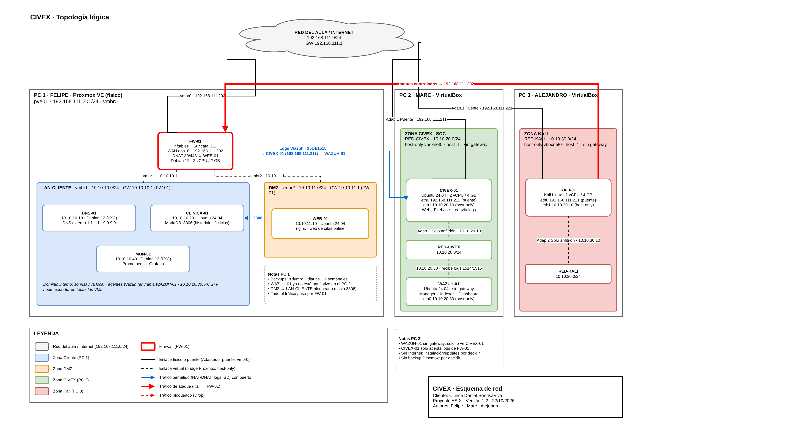

# Arquitectura de red (versión provisional)

Resumen del diseño técnico de CIVEX. Es la **versión 1**: puede cambiar durante el montaje.

> La red del aula es `192.168.111.0/24`, con el router en `192.168.111.1`.

## 1. Idea general

- La **red del aula** hace de "Internet" del proyecto.
- Cada PC tiene su **propia red de laboratorio**, separada de las demás.
- En el PC 1, **todo** lo que entra o sale pasa por un firewall (**FW-01**). Es el único punto visible desde fuera, y por tanto el objetivo de las pruebas de Kali.
- El SOC (**WAZUH-01**) está en el PC 2, dentro de la red de CIVEX. Los agentes del cliente le envían los logs a través de FW-01 y CIVEX-01.

> 💡 **Ejemplo:** es como un edificio con un único portal y un portero (FW-01). Quien viene de fuera solo puede hablar con el portero; no puede ir directamente a la puerta de cada vivienda.

## 2. Redes

| Red | Rango | Dónde está | Gateway |
|-----|-------|-----------|---------|
| Aula (Internet) | `192.168.111.0/24` | Switch de clase | Router del aula |
| LAN-CLIENTE | `10.10.10.0/24` | PC 1 (Proxmox) | `10.10.10.1` (FW-01) |
| DMZ | `10.10.11.0/24` | PC 1 (Proxmox) | `10.10.11.1` (FW-01) |
| RED-CIVEX | `10.10.20.0/24` | PC 2 (VirtualBox): CIVEX-01 y WAZUH-01 | — |
| RED-KALI | `10.10.30.0/24` | PC 3 (VirtualBox) | — |

## 3. Máquinas

| Nombre | PC | Tipo | SO | IP | Función |
|--------|----|------|----|----|---------|
| pve01 | PC 1 | Host físico | Proxmox VE 8 | `192.168.111.201` | Gestiona las VMs |
| FW-01 | PC 1 | VM | Debian 12 | WAN `192.168.111.202` · `10.10.10.1` · `10.10.11.1` | Firewall (nftables) + Suricata |
| DNS-01 | PC 1 | LXC | Debian 12 | `10.10.10.10` | Servidor DNS (`sonrisaviva.local`) |
| CLINICA-01 | PC 1 | VM | Ubuntu Server 24.04 | `10.10.10.20` | Servidor interno con base de datos (datos ficticios) |
| WEB-01 | PC 1 | VM | Ubuntu Server 24.04 | `10.10.11.10` | Web de citas (en la DMZ) |
| MON-01 | PC 1 | LXC | Debian 12 | `10.10.10.40` | Prometheus + Grafana |
| CIVEX-01 | PC 2 | VM | Ubuntu Server 24.04 | `192.168.111.211` · `10.10.20.10` | Plataforma web, Firebase, informes, backups. Reenvía los logs del cliente hacia WAZUH-01 |
| WAZUH-01 | PC 2 | VM | Ubuntu Server 24.04 | `10.10.20.30` (solo RED-CIVEX, sin gateway) | SOC / Wazuh |
| KALI-01 | PC 3 | VM | Kali Linux | `192.168.111.221` · `10.10.30.10` | Pruebas de seguridad |

## 4. Firewall (FW-01): reglas principales

Política por defecto: **bloquear todo lo que no esté permitido** y registrar lo bloqueado.

| Qué se permite | Para qué |
|----------------|----------|
| Aula → FW-01 puertos 80/443, redirigido a WEB-01 | Que la web de citas sea pública |
| Administrador → FW-01 puerto 22 | Gestionar el firewall |
| LAN-CLIENTE y DMZ → Internet (80/443) | Actualizaciones |
| LAN-CLIENTE y DMZ → DNS-01 (53) | Resolución de nombres |
| LAN-CLIENTE, DMZ y FW-01 → WAZUH-01 `10.10.20.30` (1514/1515), pasando por CIVEX-01 | Que los agentes envíen logs a WAZUH-01 (PC 2) |
| WEB-01 → CLINICA-01 (3306) | La web consulta la base de datos |
| MON-01 → todas las VMs (9100) | Monitorización |
| **DMZ → LAN-CLIENTE: BLOQUEADO** | Si la web se compromete, no llega a los datos internos |

### 4.1 Camino de los logs hacia WAZUH-01

WAZUH-01 está en RED-CIVEX, una red privada del PC 2 que el PC 1 no ve directamente. Por eso la idea es que los logs pasen por CIVEX-01, que está en la red del aula y en RED-CIVEX:

```
Agentes (LAN-CLIENTE, DMZ, FW-01) ──► FW-01 ──► CIVEX-01 (192.168.111.211) ──► WAZUH-01 (10.10.20.30)
```

| Máquina | Qué se espera de ella |
|---------|-----------------------|
| **Agentes** | Envían los logs a `10.10.20.30`. |
| **FW-01** | Deja salir esos logs hacia CIVEX-01 (puertos 1514/1515). |
| **CIVEX-01** | Los pasa a WAZUH-01 y solo acepta los que vienen de FW-01. |
| **WAZUH-01** | Una sola tarjeta en RED-CIVEX (`10.10.20.30`), sin gateway. |

- CIVEX-01 y WAZUH-01 están en la misma red, así que hablan directamente.
- RED-CIVEX no tiene salida a Internet, así que habrá que decidir cómo instalar y actualizar WAZUH-01.
- **Por comprobar al montarlo:** cómo identifica WAZUH-01 a los agentes cuando los logs llegan a través de CIVEX-01.

## 5. Pruebas previstas para validar el diseño

1. Desde Kali, `curl http://192.168.111.202` debe mostrar la web de WEB-01.
2. Desde Kali, un escaneo (`nmap`) solo debe ver los puertos 22, 80 y 443.
3. Desde Kali, `ping 10.10.10.20` debe **fallar**: la red del cliente no está expuesta.
4. Desde CLINICA-01 y WEB-01 debe poder llegarse a WAZUH-01 (`10.10.20.30`) por el puerto 1514.
5. Desde WEB-01, el resto de puertos de WAZUH-01 (por ejemplo el 22) deben estar **bloqueados**: solo se permiten 1514 y 1515.
6. Desde Kali **no** debe poder llegarse a WAZUH-01.
7. Las alertas de las pruebas, y los logs de los agentes del PC 1 y de CIVEX-01, deben aparecer en el dashboard de Wazuh.

## 6. Esquema

Topología lógica completa (el fichero editable está en [`img/Esquemadered.drawio`](../img/Esquemadered.drawio)):


